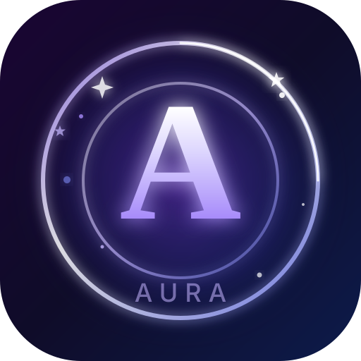

# ✦ Aura — Kişisel Yaşam Asistanı

<p align="center">
  
</p>

<p align="center">
  Hayatının farklı yönlerini tek çatı altında yönet.
  <br />
  <strong>React 19 · Firebase · Tailwind CSS · PWA · Capacitor</strong>
</p>

<p align="center">
  <a href="https://aura-75601.web.app">🌐 Canlı Demo</a> &nbsp;·&nbsp;
  <a href="#kurulum">⚙️ Kurulum</a> &nbsp;·&nbsp;
  <a href="#modüller">📦 Modüller</a>
</p>

---

## 📖 Hakkında

**Aura**, günlük hayatını düzenlemek için tasarlanmış, modüler bir kişisel yaşam yönetim uygulamasıdır. Sadece ihtiyacın olan modülleri aktif et — sade, odaklı ve tamamen senin için.

- 🔐 **Firebase Auth** ile güvenli giriş (Google + E-posta)
- ☁️ **Firestore** ile bulut tabanlı veri senkronizasyonu
- 📱 **PWA** desteği — cihazına yükleyebilirsin

---

## 📦 Modüller

| Modül | Açıklama |
|-------|----------|
| ✦ **Ana Sayfa** | Günlük özet ve hızlı erişim paneli |
| ▤ **Ajanda** | Günlük planların ve geçmiş kayıtların |
| ◫ **Takvim** | Takvim görünümü ve etkinlik yönetimi |
| ❖ **Günlük Düzen** | Alışkanlık takibi, zincirleri kırma |
| ✦ **Cilt Bakımı** | Sabah & gece rutinleri, ürün yönetimi |
| ◈ **İzleme Arşivi** | Film, dizi, kitap, podcast listesi |
| ◎ **Sınav Takibi** | Net hedefleri, ders saatleri, grafikler |
| ○ **Döngü Takibi** | Aylık döngü ve belirtiler (özel & güvenli) |
| ☽ **Maneviyat & Huzur** | Namaz vakitleri, dua & zikir rutinleri |
| 📊 **İstatistikler** | Genel kullanım istatistikleri |
| ⚯ **Sosyal & Odalar** | Topluluk ve motivasyon |

---

## 🛠️ Kullanılan Teknolojiler

- **Frontend:** React 19 + Vite 8
- **Styling:** Tailwind CSS v4
- **Backend & Database:** Firebase (Firestore + Authentication)
- **Veri Görselleştirme:** Recharts
- **PWA:** vite-plugin-pwa
- **Mobil:** Capacitor (Android)
- **Animasyon:** Canvas Confetti

---

## ⚙️ Kurulum

### Gereksinimler

- Node.js 22+
- npm 9+
- Firebase CLI (`npm install -g firebase-tools`)
- Firebase projesi

### Adımlar

```bash
# 1. Repoyu klonla
git clone https://github.com/NevraNurDogan/Aura.git
cd Aura

# 2. Bağımlılıkları yükle
npm install

# 3. Ortam değişkenlerini ayarla
cp .env.example .env
# .env dosyasını açıp Firebase bilgilerini gir

# 4. Geliştirme sunucusunu başlat
npm run dev
```

### Firebase Kurulumu

1. [Firebase Console](https://console.firebase.google.com)'da yeni proje oluştur
2. **Authentication** → E-posta/Şifre ve Google giriş yöntemlerini etkinleştir
3. **Firestore Database** oluştur
4. Proje ayarlarından SDK bilgilerini al
5. `.env` dosyasına yapıştır

---

## 🔒 Güvenlik

- `VITE_` ile başlayan değerler ve Firebase istemci API anahtarı web derlemesinde görünür; bunları servis sırrı olarak kullanmayın. Firebase istemci API anahtarı için Google Cloud Console'da API ve uygulama kısıtlamaları kullanın.
- TMDB aramaları tarayıcıdan doğrudan yapılır; `VITE_TMDB_API_KEY` değerini yerel `.env` dosyasında tanımlayın. Bu anahtar derlenen istemci kodunda görünür ve gizli bir sunucu sırrı değildir.
- `.env` dosyası repoya eklenmemelidir. Bir anahtar sızarsa sağlayıcıdan iptal edip yenileyin; kaynak koddan silmek tek başına yeterli değildir.
- Firestore'da özel kullanıcı belgeleri yalnızca belge sahibine açıktır. Sosyal özellikler için gereken sınırlı alanlar `public_profiles` belgelerinde tutulur.
- Döngü takibi verileri Firestore güvenlik kurallarıyla korunur.

Önceden `profiles` koleksiyonunda bulunan kullanıcılar, sosyal özellikleri kullandıkça sınırlı `public_profiles` kaydı otomatik oluşturulur; e-posta ve arkadaş listesi bu kayda kopyalanmaz.

---

## 📱 PWA Olarak Yükleme

Aura'yı telefon veya bilgisayarına uygulama olarak yükleyebilirsin:

1. Uygulamayı tarayıcıda aç
2. Giriş ekranındaki **"Uygulamayı Cihazına Yükle"** butonuna tıkla
3. Ya da tarayıcı menüsünden "Ana Ekrana Ekle" / "Uygulamayı Yükle" seçeneğini kullan

---

## 🚀 Canlı Proje

Bu proje Firebase Hosting üzerinde yayındadır:  
🌐 **https://aura-75601.web.app**

---

## 📄 Lisans

Bu proje kişisel kullanım amaçlı geliştirilmiştir.

---

<p align="center">Made with ♥ by <a href="https://github.com/NevraNurDogan">Nevra Nur Doğan</a></p>
